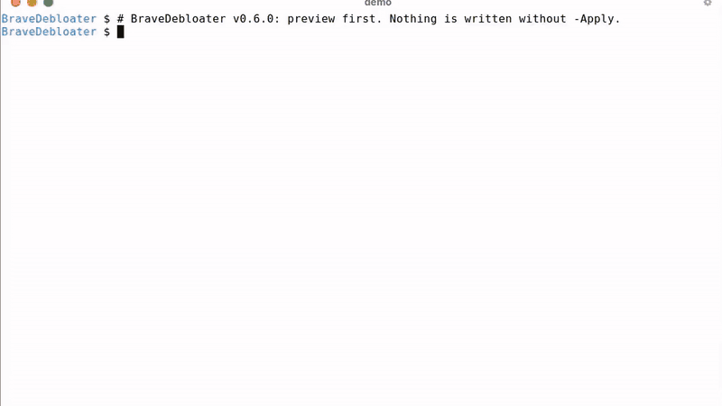
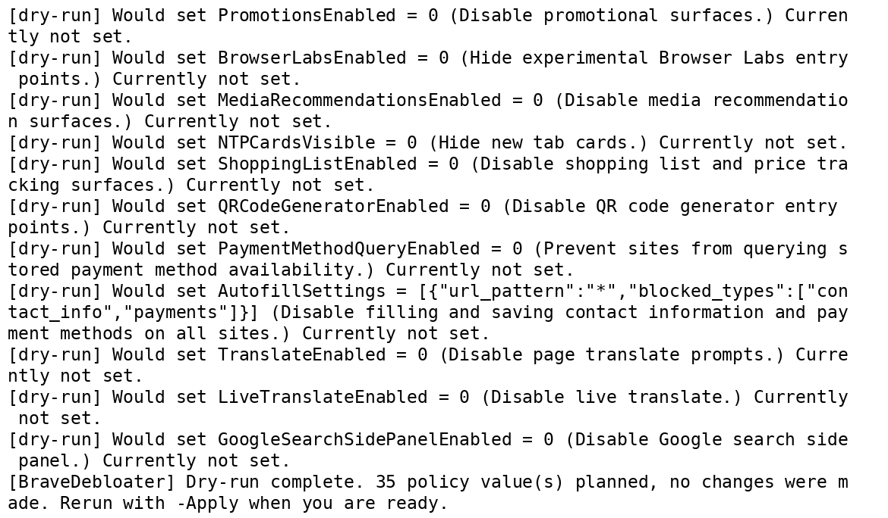
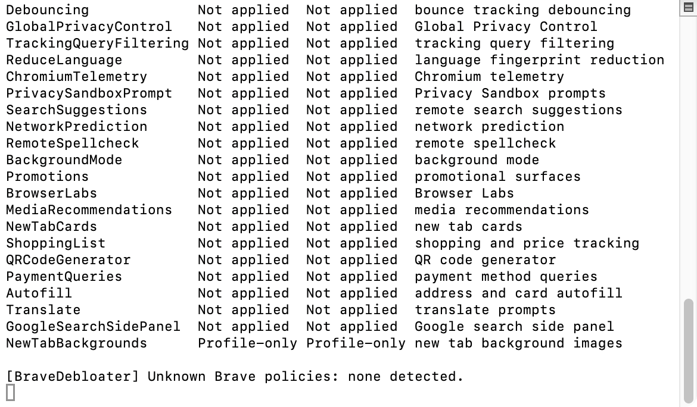
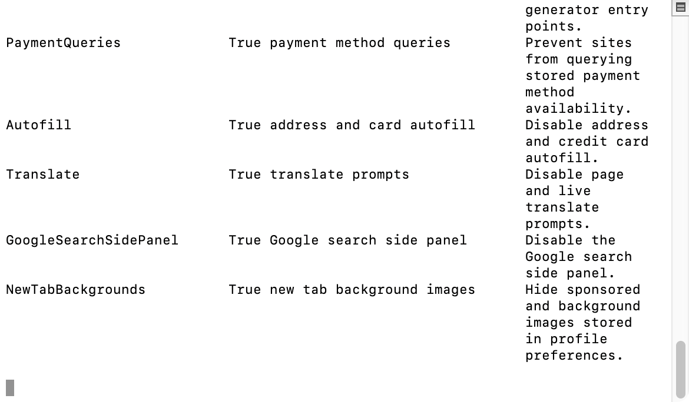

<p align="center">
  
</p>

<h1 align="center">BraveDebloater</h1>

<p align="center">
  Turn off the parts of Brave Browser you do not use, and undo it whenever you want.
</p>

<p align="center">
  <a href="https://www.producthunt.com/products/bravedebloater?embed=true&amp;utm_source=badge-featured&amp;utm_medium=badge&amp;utm_campaign=badge-bravedebloater" target="_blank" rel="noopener noreferrer"></a>
</p>


[](https://github.com/osfv/BraveDebloater/actions/workflows/ci.yml)
[](LICENSE)

<p align="center">
  
</p>

BraveDebloater is a free PowerShell script that switches off Brave extras such as Rewards, Wallet, VPN, Leo AI, News, and telemetry. It uses the official Brave and Chromium enterprise policies, so it does not patch Brave or install anything into it.

- **Preview first.** The script only shows what it would change. It leaves Brave's policies and profile files alone until you add `-Apply`.
- **Easy to undo.** Each apply run saves a backup, and one command restores it.
- **Nothing hidden.** Every policy it sets is listed in `brave://policy`.

<p>
   Windows/macOS/Linux
  &nbsp;·&nbsp;
   PowerShell runtime
  &nbsp;·&nbsp;
   Open source
</p>

Prefer clicking to typing? Pick features and copy the matching command at [bravedebloater.tersa.tech](https://bravedebloater.tersa.tech).

> Not affiliated with or endorsed by Brave Software.

## Demo

[](assets/videos/bravedebloater-linux-demo.mp4)

The clip above is a 34-second cut. [Watch the full Linux demo (87 seconds, MP4)](assets/videos/bravedebloater-linux-demo.mp4): preview the cleanup, apply it, and undo it from a backup.

## Quick Start

You need PowerShell: Windows PowerShell 5.1 (built into Windows) or PowerShell 7 on Windows, macOS, or Linux.

**1. Install.** Paste this into PowerShell. It downloads the latest release, checks its SHA256 hash, and does not touch Brave.

```powershell
irm https://raw.githubusercontent.com/osfv/BraveDebloater/main/install.ps1 | iex
```

The installer prints the folder it used. Open PowerShell in that folder for the next steps. Scoop, winget, and manual downloads are covered in [docs/install.md](docs/install.md).

**2. Preview.** This lists every change and writes nothing.

```powershell
.\Invoke-BraveDebloat.ps1
```

**3. Apply.** If the preview looks right, run it again with `-Apply`. A backup is saved first.

```powershell
.\Invoke-BraveDebloat.ps1 -Apply
```

On Linux the policy file lives in `/etc/brave`, so run the apply command with `sudo pwsh`.

**4. Restart Brave.** Open `brave://policy` to see the policies that loaded.

**5. Undo, if you change your mind.** Preview the restore, then add `-Apply`.

```powershell
.\Invoke-BraveDebloat.ps1 -UndoFromBackup Latest
.\Invoke-BraveDebloat.ps1 -UndoFromBackup Latest -Apply
```

## What It Removes

Choose how far to go with `-Preset`. Without it, the script uses `Extreme`.

| Preset | What it turns off |
| --- | --- |
| `Standard` | Brave extras: Rewards, Wallet, VPN, Leo AI Chat, News, Talk, Playlist, Email Aliases, Speedreader, and Wayback prompts. Brave telemetry: P3A, stats ping, and Web Discovery. |
| `High` | Everything in `Standard`. It also keeps Brave's privacy protections on (De-AMP, debouncing, Global Privacy Control, tracking parameter filtering, reduced language fingerprinting) and turns off Chromium metrics, URL-keyed data collection, remote search suggestions, network prediction, and remote spellcheck. |
| `Extreme` | Everything in `High`, plus extra UI: background mode, promotions, Browser Labs, media recommendations, new tab cards, shopping list, QR generator, payment method queries, autofill, translate prompts, and the Google search side panel. |

```powershell
.\Invoke-BraveDebloat.ps1 -Preset Standard
```

Optional add-ons:

| Add this | To |
| --- | --- |
| `-LockShields` | Enforce stricter Brave Shields defaults: ad blocking, fingerprinting protection, HTTPS upgrades, and stricter referrers. |
| `-IncludeProfilePreferences` | Also hide some new tab, sponsored background, and toolbar items. This edits each profile's `Preferences` file, so close Brave first. |
| `-DnsOverHttps` | Set Brave's DNS-over-HTTPS mode, with a resolver you choose. It adds to the preset or features in the same command. See [DNS control](docs/usage.md#dns-control). |

## Turn Off One Feature

Each command is a preview and names the policies it would set. Add `-Apply` to write them, then restart Brave.

| I want to | Command |
| --- | --- |
| Disable Brave Rewards and BAT prompts permanently | `.\Invoke-BraveDebloat.ps1 -OnlyFeature Rewards` |
| Remove the Brave Wallet icon and prompts | `.\Invoke-BraveDebloat.ps1 -OnlyFeature Wallet` |
| Hide Brave VPN | `.\Invoke-BraveDebloat.ps1 -OnlyFeature VPN` |
| Turn off Leo AI (sidebar, address bar, context menu) | `.\Invoke-BraveDebloat.ps1 -OnlyFeature LeoAI` |
| Remove Brave News from the new tab page | `.\Invoke-BraveDebloat.ps1 -OnlyFeature News` |
| Disable Brave Talk | `.\Invoke-BraveDebloat.ps1 -OnlyFeature Talk` |
| Disable Playlist | `.\Invoke-BraveDebloat.ps1 -OnlyFeature Playlist` |
| Disable Email Aliases | `.\Invoke-BraveDebloat.ps1 -OnlyFeature EmailAliases` |
| Stop Brave telemetry (P3A, stats ping, Web Discovery) | `.\Invoke-BraveDebloat.ps1 -OnlyFeature BraveTelemetry` |
| Stop Chromium metrics and URL-keyed data collection | `.\Invoke-BraveDebloat.ps1 -OnlyFeature ChromiumTelemetry` |
| Hide sponsored new tab backgrounds and cards | `.\Invoke-BraveDebloat.ps1 -OnlyFeature NewTabBackgrounds,NewTabCards -IncludeProfilePreferences` |

Combine several with commas (`-OnlyFeature Rewards,Wallet,VPN,LeoAI`), or start from a preset and keep what you like with `-ExcludeFeature News,LeoAI`. `-ListFeatures` prints every feature name.

## What It Does Not Do

- It does not disable Brave updates. Update policies are on the blocklist and the tool refuses to write them.
- It does not turn off Brave Shields, add Shield allowlists, or weaken Safe Browsing. The optional `-LockShields` add-on only enforces stricter Shields defaults.
- It does not edit your hosts file, remove extensions, patch Brave binaries, or install anything into Brave.
- It does not run hidden. Every policy it sets is listed in `brave://policy` with its value, and `-Doctor` reports the current state read-only.
- It does not change Brave's policies or profile files without `-Apply`. A report (`-ReportPath`) or export (`-ExportPolicyPath`) writes the file you name in a preview too, so do not name Brave's own policy file as the export. Unless you use `-NoBackup` for a policy-only run, every apply run leaves a JSON backup that `-UndoFromBackup` can restore.

## Screenshots

Read-only output from the script. Click a picture to open it full size.

| Preview (default run) | Health check (`-Doctor`) | Feature list (`-ListFeatures`) |
| --- | --- | --- |
| [](assets/screenshots/default-dry-run.png) | [](assets/screenshots/doctor.png) | [](assets/screenshots/list-features.png) |

## Handy Commands

| I want to | Command |
| --- | --- |
| Check what is set right now, without changing anything | `.\Invoke-BraveDebloat.ps1 -Doctor` |
| See every feature name | `.\Invoke-BraveDebloat.ps1 -ListFeatures` |
| Answer yes or no for each feature | `.\Invoke-BraveDebloat.ps1 -Customize` |
| Save an HTML report of the run | `.\Invoke-BraveDebloat.ps1 -ReportPath .\brave-report.html` |
| List my backups | `.\Invoke-BraveDebloat.ps1 -ListBackups` |
| Apply for every user on this computer (needs administrator or root) | `.\Invoke-BraveDebloat.ps1 -Scope LocalMachine -Apply` |
| Print the tool version for a bug report | `.\Invoke-BraveDebloat.ps1 -Version` |

The [usage guide](docs/usage.md) explains every option.

## Why Policies Instead of Settings

Brave can reset or re-promote settings after updates. Enterprise policies stay enforced on every start, show up in `brave://policy`, and come off cleanly when you restore the backup.

| Approach | Survives Brave updates | Visible in `brave://policy` | Undo | Touches binaries, hosts, or extensions |
| --- | --- | --- | --- | --- |
| **BraveDebloater policies** | Yes | Yes | Backup restore | No |
| `brave://settings` toggles | Often reset or re-promoted | No | Manual | No |
| A random `.reg` gist | Maybe | If the gist used policies | Only if you kept a copy | Sometimes |
| Scripts that disable Shields or updates | Yes, but they weaken Brave | Yes | Painful | Sometimes |

On Windows and macOS, Brave Origin is a paid stripped-down build. This tool keeps the Brave you already have and applies the same class of official policies for free.

## Platforms

| Platform | Where the policies go |
| --- | --- |
| Windows | Brave policy keys in the registry |
| macOS | `defaults` for the current user, or a managed plist for the whole machine |
| Linux | A JSON policy file in `/etc/brave/policies/managed/` |
| Android, iOS/iPadOS | No local writes. `-ExportPolicyPath` creates a file for your MDM. |

Details are in [Platform support](docs/usage.md#platform-support).

## More Help

- [Install options](docs/install.md): Scoop, winget, manual download, and how to verify a release
- [Usage guide](docs/usage.md): presets, feature toggles, DNS, profile preferences, Doctor, restore, and exports
- [Changelog](CHANGELOG.md) and [roadmap](ROADMAP.md)
- [Contributing](CONTRIBUTING.md): project checks and the release process
- [Security policy](SECURITY.md)

## Sources

Policy names and values come from Brave's official Group Policy documentation and Brave policy templates:

- <https://support.brave.app/hc/en-us/articles/360039248271-Group-Policy>
- <https://brave-browser-downloads.s3.brave.com/latest/policy_templates.zip>

[docs/debloatable-validation.md](docs/debloatable-validation.md) lists the template version, the policy choices, and the validation commands.

## License

[MIT](LICENSE)
